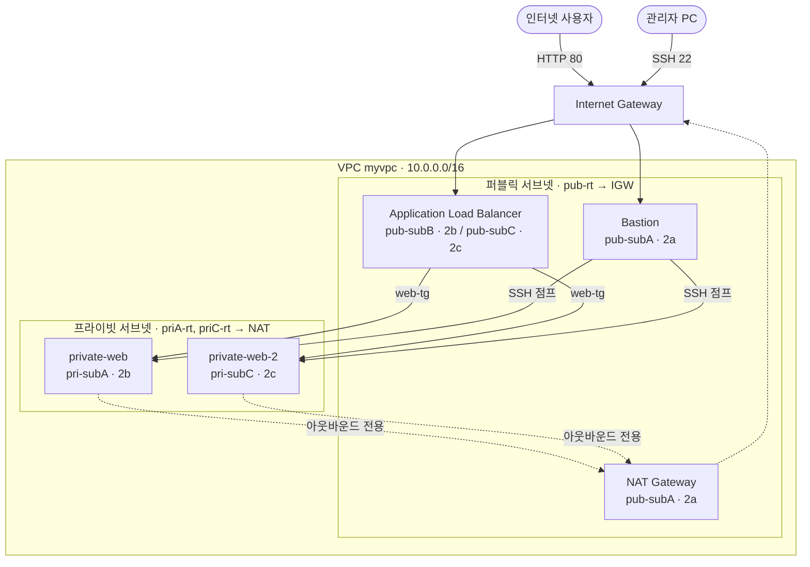

# AWS 고가용성 웹 인프라 구축 (VPC · Bastion · NAT · ALB)

AWS 콘솔에서 VPC부터 로드밸런서까지 네트워크를 직접 설계하고 구축한 실습 프로젝트입니다.
퍼블릭/프라이빗 서브넷을 분리하고, 배스천 호스트로만 관리 접속하며, ALB로 두 가용 영역의 웹서버에 트래픽을 분산하는 **실무형 2계층 구조**를 만들었습니다.

- **리전:** 아시아 태평양(서울) `ap-northeast-2`
- **기간:** 2026.10
- **주요 서비스:** VPC, EC2, Internet Gateway, NAT Gateway, Elastic IP, Security Group, Application Load Balancer, Target Group

---

## 1. 아키텍처



### 트래픽 흐름
| 흐름 | 경로 |
|---|---|
| 사용자 웹 접속 | 사용자 → IGW → **ALB** → 대상 그룹 → 프라이빗 웹서버 |
| 관리자 SSH 접속 | 관리자 PC → IGW → **Bastion** → (VPC 내부) → 프라이빗 웹서버 |
| 서버 패키지 설치 | 프라이빗 웹서버 → **NAT Gateway** → IGW → 인터넷 (나가는 방향만 허용) |

---

## 2. 네트워크 설계

### 서브넷
| 이름 | 구분 | 가용 영역 | CIDR | 라우팅 테이블 | 용도 |
|---|---|---|---|---|---|
| pub-subA | 퍼블릭 | 2a | 10.0.1.0/24 | pub-rt | Bastion, NAT Gateway |
| pub-subB | 퍼블릭 | 2b | 10.0.3.0/24 | pub-rt | ALB 노드 |
| pub-subC | 퍼블릭 | 2c | 10.0.2.0/24 | pub-rt | ALB 노드 |
| pri-subA | 프라이빗 | 2b | 10.0.11.0/24 | priA-rt | 웹서버 1 |
| pri-subC | 프라이빗 | 2c | 10.0.12.0/24 | priC-rt | 웹서버 2 |

CIDR 세 번째 자리로 역할을 구분했습니다. `1~3`은 퍼블릭, `11~12`는 프라이빗입니다.

### 라우팅 테이블
| 라우팅 테이블 | 대상 | 타겟 |
|---|---|---|
| pub-rt | 10.0.0.0/16 | local |
| | 0.0.0.0/0 | **Internet Gateway** |
| priA-rt, priC-rt | 10.0.0.0/16 | local |
| | 0.0.0.0/0 | **NAT Gateway** |

서브넷 자체에는 퍼블릭/프라이빗 구분이 없습니다. **라우팅 테이블이 IGW로 연결되면 퍼블릭, 그렇지 않으면 프라이빗**이 됩니다.

### 보안 그룹 (최소 권한 원칙)
| 보안 그룹 | 적용 대상 | 인바운드 | 아웃바운드 |
|---|---|---|---|
| alb-sg | ALB | HTTP 80 ← `0.0.0.0/0` | 전체 허용 |
| web-sg | Bastion | SSH 22 ← **관리자 IP/32** | 전체 허용 |
| private-web-sg | 웹서버 2대 | SSH 22 ← **web-sg**<br/>HTTP 80 ← **VPC 내부(→ alb-sg로 축소 예정)** | 전체 허용 |

소스에 IP 대신 **보안 그룹 ID**를 지정해, 배스천의 IP가 바뀌어도 규칙을 수정할 필요가 없도록 했습니다.

---

## 3. 구축 과정

1. **VPC 구성:** VPC, 서브넷, Internet Gateway, 라우팅 테이블을 콘솔에서 직접 생성 (자동 생성 옵션 미사용)
2. **퍼블릭 EC2:** Amazon Linux 2023에 Apache(httpd) 설치, 보안 그룹으로 22·80 포트 제어
3. **Bastion 접속:** MobaXterm의 SSH 점프 호스트로 프라이빗 서버에 접속 (배스천에 키를 남기지 않는 방식)
4. **NAT Gateway:** 프라이빗 서버가 외부 저장소에서 패키지를 내려받을 수 있도록 아웃바운드 경로 구성
5. **사용자 데이터 자동화:** 두 번째 웹서버는 부팅 시 스크립트로 웹서버 설치를 자동화
   ```bash
   #!/bin/bash
   dnf -y install httpd
   systemctl --now enable httpd
   echo "<h1>Hello from private-web-2 (2c)</h1>" > /var/www/html/index.html
   ```
6. **ALB + 대상 그룹:** 인터넷 경계 ALB를 2b·2c 퍼블릭 서브넷에 배치하고 두 웹서버를 대상으로 등록
7. **고가용성 검증:** 웹서버 1대를 중지해도 ALB가 자동으로 대상에서 제외하고 나머지 서버로 서비스가 계속됨을 확인

---

## 4. 트러블슈팅

| # | 증상 | 원인 | 해결 | 배운 점 |
|---|---|---|---|---|
| 1 | 특정 리전에서 모든 API가 `액세스 거부` | AWS Organizations의 **SCP**가 허용 리전을 제한 | 정책 범위 확인 후 허용된 환경에서 실습 | IAM 권한이 있어도 **SCP가 상한선**을 정함 |
| 2 | 서브넷 생성 시 CIDR 충돌 | 오타로 프리픽스가 `/0`이 되어 모든 대역과 겹침 | `10.0.12.0/24`로 수정 | `/` 뒤 숫자가 작을수록 범위가 넓어짐 |
| 3 | 보안 그룹 생성 실패 | 이름이 `sg-`로 시작 | `web-sg`로 변경 | `sg-`는 보안 그룹 ID 접두사로 예약됨 |
| 4 | 인스턴스가 의도와 다른 VPC에 생성 | 시작 마법사의 네트워크 설정 **편집** 누락 → 기본 VPC 사용 | 재생성 후 **프라이빗 IP·VPC ID로 배치 위치 검증** | 생성 직후 위치를 확인하는 습관 |
| 5 | 프라이빗 IP로 SSH 타임아웃 | 사설 IP는 인터넷에서 라우팅되지 않음 | Bastion을 **SSH 점프 호스트**로 설정 | 프라이빗 서버는 VPC 내부 경유로만 접근 |
| 6 | 점프 접속 시 비밀번호 요구 | SSH가 2단계인데 키를 한 단계에만 지정 | 게이트웨이와 목적지 **양쪽에 키 지정** | EC2는 비밀번호 로그인이 없어 키 인증 실패 시 접속 불가 |
| 7 | NAT를 연결했는데도 패키지 설치 타임아웃 | 보안 그룹 **아웃바운드 규칙** 누락 | 아웃바운드 `0.0.0.0/0` 추가 | SG는 **스테이트풀**: 인바운드 SSH의 응답은 허용되지만, 서버가 먼저 나가는 연결은 아웃바운드 규칙이 필요 |
| 8 | `dnf`가 잠금 대기 상태 | 이전에 중단한 dnf 프로세스가 남음 | `ps`로 확인 후 `kill` | 프로세스 확인 → 종료 순서 |
| 9 | `curl` 즉시 실패 (`after 0 ms`) | httpd를 설치만 하고 실행하지 않음 | `systemctl --now enable httpd` | **즉시 거부 = 서비스 없음**, **타임아웃 = SG·라우팅 차단** |
| 10 | ALB가 한쪽 서버로 트래픽을 보내지 않음 | 서버의 가용 영역(2b)에 ALB 서브넷이 없음 | 2b 퍼블릭 서브넷 추가 후 ALB에 매핑 | ALB는 **활성화된 가용 영역의 대상**에만 라우팅 |
| 11 | 대상 그룹 상태 검사 `403` | 웹 루트에 `index.html`이 없음 | 페이지 생성, `curl -I`로 200 확인 | 상태 검사는 **200만 정상**으로 판단 |

### 장애 원인 분리 기준
| 관찰 결과 | 의심할 계층 |
|---|---|
| Connection timed out | 보안 그룹, 라우팅 테이블, NACL |
| Connection refused / 즉시 실패 | 대상 서버의 서비스(프로세스) 미실행 |
| HTTP 403 / 404 | 웹서버 설정, 파일 경로 |
| HTTP 502 / 503 | 백엔드 서버 응답 불가 |

---

## 5. 비용 관리
- NAT Gateway, ALB, 퍼블릭 IPv4는 **시간당 과금**이므로 실습 종료 시 삭제
- 정리 순서: **ALB 삭제 → NAT Gateway 삭제 → Elastic IP 릴리스 → 인스턴스 중지**
- VPC, 서브넷, 라우팅 테이블, 보안 그룹, 대상 그룹은 무료이므로 유지
- AWS Budgets로 예산 알람 설정

---

## 6. 다음 단계
- [ ] 웹서버 HTTP 인바운드 소스를 `alb-sg`로 축소
- [ ] **RDS**를 프라이빗 서브넷에 추가하고 WordPress 연동 → 3계층 웹서비스
- [ ] **Auto Scaling 그룹**으로 장애 시 자동 복구와 확장
- [ ] **Terraform**으로 전체 구성을 코드화
- [ ] HTTPS 적용 (ACM 인증서 + Route 53)
- [ ] 가용 영역별 NAT Gateway 구성으로 단일 장애 지점 제거

### 개선할 점
- 프라이빗 서브넷 `pri-subA`가 이름과 달리 2b에 생성됨 → 재구축 시 2a로 맞출 예정
- NAT Gateway가 2a 한 곳에만 있어, 2a 장애 시 프라이빗 서버의 외부 통신이 끊김
